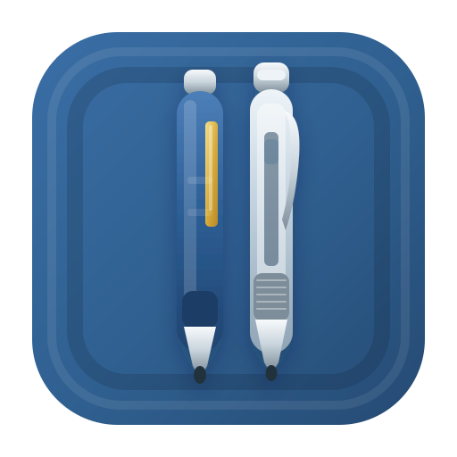

<p align="center">
  
</p>

# 🖊️ Pen Fight

**The best five minutes of the school day, rebuilt for the browser.**

Remember the back bench? The bell just rang, the teacher's gone, and two pens are standing upright on a scratched wooden desk. Pen Fight brings that duel online. Pull back, let go, and knock your rival's pen off the edge, either against a friend on the same device or against the computer.

🔗 **Live demo:** [Take a seat at Table 03 →](https://samanway-koley.github.io/penfight/)

     

---

> *Room 302 · period 05 · after the bell*
> *Two pens enter. One stays on the desk.*

## ✨ Features

- **Pull back, then let go** — Press on your own pen and drag away from your target. A short pull is a gentle tap, and a long pull into the red is a risky power shot.
- **Two ways to play** — Pass the device to a friend, or go solo against the computer.
- **A bot with moods** — Easy, Medium and Hard set how sweaty your opponent gets.
- **Pick your weapon** — Ball Pen, Gel Grip or Fountain Pen. Each one slides, hits and grips differently, so your choice is a strategy.
- **Spin it to win it** — Hit off-centre to add spin, and curl your rival toward the edge.
- **No button mashing** — The next turn unlocks only when both pens stop moving. Patience wins rounds.
- **Real desk rules** — A pen falls when its centre crosses the edge. Flick yourself off without touching your rival and it's a foul.
- **Best-of-3 or best-of-5** — First to 2 or 3 rounds takes the series, and the opening break swaps sides every round.
- **A proper scorecard** — Tracks the series score and round clock, with a one-tap restart or a change of pens.
- **Make it yours** — Choose a colour for each player's pen before the match.
- **Plays on your phone** — Built for touch, so you can duel on the bus ride home.

## 🖥️ How It Works

1. Hit **Start a duel** to reach the match setup screen.
2. Choose **Pass & play** (two humans) or **vs Computer** (solo practice). Against the bot, pick Easy, Medium or Hard.
3. Pick a pen and colour for each player, then choose Best of 3 or Best of 5.
4. Start the match. Both pens begin upright on the wooden desk, and the break alternates every round.
5. On your turn, press your own pen and drag back. A power meter shows how hard the flick will be.
6. Release. Off-centre hits add spin, and every pen type behaves differently.
7. Wait for both pens to stop. Only then does the next turn unlock.
8. A round ends when a pen's centre crosses the desk edge. If both pens fall, the one that fell later loses. A dead tie is a draw and the round is replayed.
9. The first player to the required round wins takes the series. Then choose **Rematch** or **Change pens**.

### 🎒 Choose Your Pen

| Pen | Style | Feel | Speed | Hit | Grip |
|---|---|---|:-:|:-:|:-:|
| **Ball Pen** | Reynolds 045 style | Fast slide, light hit | 5 | 2 | 3 |
| **Gel Grip** | Cello Gripper style | Steady slide, all-rounder | 3 | 3 | 5 |
| **Fountain** | Parker style | Short slide, heavy hit | 2 | 5 | 3 |

## 🛠️ Tech Stack

| Layer | Technology |
|---|---|
| Markup | [HTML5](https://developer.mozilla.org/en-US/docs/Web/HTML) |
| Styling | [CSS3](https://developer.mozilla.org/en-US/docs/Web/CSS) |
| Rendering | [HTML5 Canvas (2D)](https://developer.mozilla.org/en-US/docs/Web/API/Canvas_API) |
| Game logic | Vanilla [JavaScript](https://developer.mozilla.org/en-US/docs/Web/JavaScript), no frameworks or game engines |
| Fonts | [Google Fonts](https://fonts.google.com/) (Caveat, Nunito Sans, Patrick Hand, Schoolbell) |
| Hosting | [GitHub Pages](https://pages.github.com/) |

## 📁 Project Structure

```text
penfight/
├── index.html            # Page markup: setup screen, scorecard, rulebook
├── styles.css            # Desk, paper and UI styling
├── app.js                # Game loop, canvas rendering, physics, bot and rules
├── manifest.webmanifest  # Web app manifest for home-screen installs
└── logo.svg              # Site logo, favicon and social preview image
```

## 🚀 Getting Started Locally

No build step, no dependencies, no homework. Clone it, serve it, play it.

```bash
# Grab the desk
git clone https://github.com/Samanway-Koley/penfight.git
cd penfight

# Serve the folder locally (Python 3)
python3 -m http.server 8000

# Then open http://localhost:8000 and start flicking
```

> ⚠️ Serve over `http://localhost` rather than opening `index.html` via `file://`, since some browsers restrict features on local files.

## 🌐 Deployment

Pen Fight lives on GitHub Pages and deploys straight from the repository, so there is nothing to build. Push your changes and the desk updates at `https://<username>.github.io/penfight/`.

## 🤝 Contributing

Got a new pen type, a smarter bot or a bug that ruined your winning streak? Contributions, bug reports, and feature requests are welcome!

1. Fork the repository
2. Create a feature branch: `git checkout -b feature/my-feature`
3. Commit your changes: `git commit -m "Add my feature"`
4. Push to the branch: `git push origin feature/my-feature`
5. Open a Pull Request

Please keep PRs focused and include a short description of the problem being solved.

## 👤 Author

**Samanway Koley**

- GitHub: [@Samanway-Koley](https://github.com/Samanway-Koley)
- LinkedIn: [Samanway Koley](https://www.linkedin.com/in/samanway-koley)
- Email: samanway.koley@gmail.com

---

<p align="center"><i>Pens before phones.</i><br/>If you find this game useful, consider giving the repo a ⭐ — it helps others discover it.</p>
